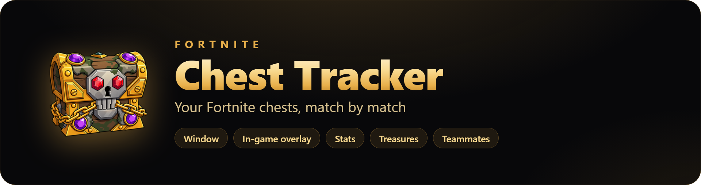
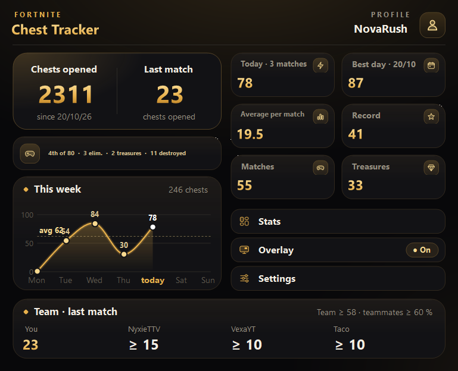
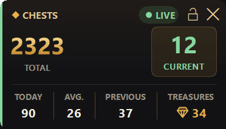
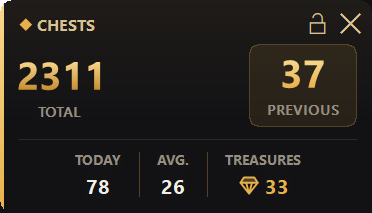
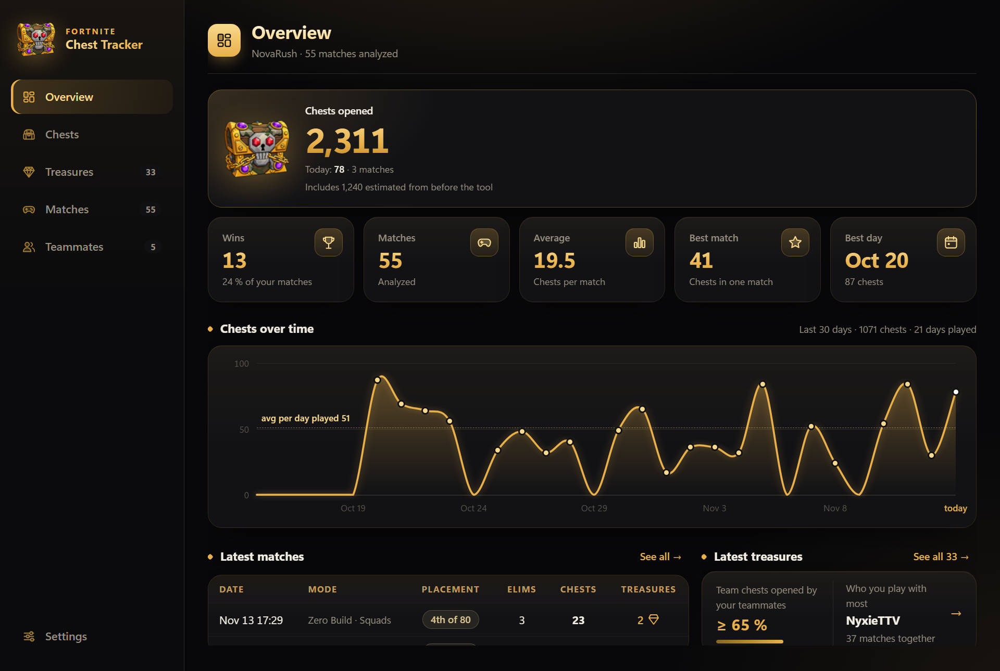
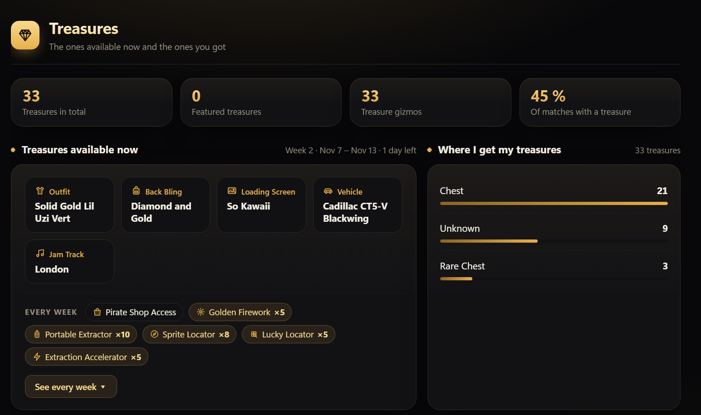
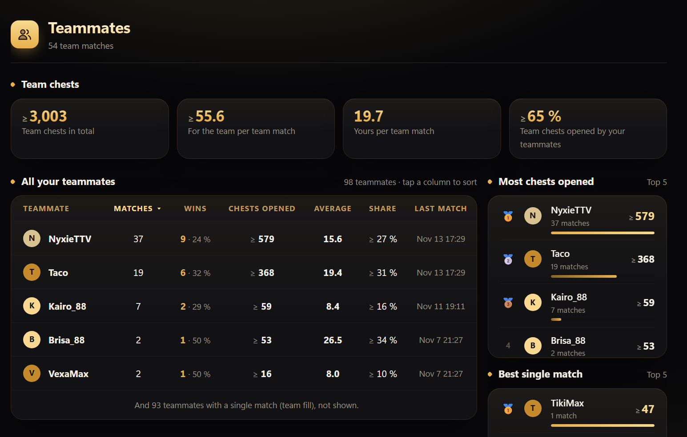
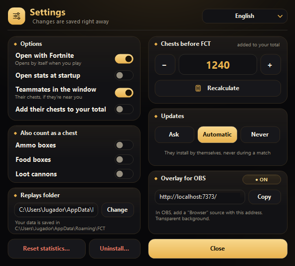

<div align="center">



[Español](README.md) · **English**

[](../../releases/latest) [](../../releases)  

### [⬇&nbsp; Download FCT.exe](../../releases/latest)

One file · nothing to install · English and Spanish

<br>



</div>

<br>

## ✨ What it does

FCT counts **every chest you open in Fortnite**, match after match, without you doing anything: you play, it keeps count.

|   |   |
|---|---|
| 🧰 **Your chest total** | All time, today, your best day, your record and your average per match. |
| 🎮 **In-game overlay** | Your chests on top of Fortnite, live while you play. |
| 📊 **Stats** | A page with charts, your matches, your treasures and your team. |
| 💎 **Treasures** | The treasure hunt ones: which you got and which are out this week. |
| 👥 **Teammates** | Who you play with most and how many chests each one opens. |
| 📺 **For streamers** | The same overlay, ready for OBS with a transparent background. |

Your history stays saved on your PC.

<br>

## 🚀 Start in 3 steps

1. **Download [`FCT.exe`](../../releases/latest)** and open it. Nothing to install.
2. **Turn on replays in Fortnite:** *Settings → Game → Replays → Record Replays*. That is what FCT reads to count.
3. **Play.** FCT opens by itself with Fortnite and counts your chests at the end of every match.

> [!NOTE]
> The first time, Windows may show a blue warning (*"Windows protected your PC"*). It is normal for new programs that still have few downloads: click **More info → Run anyway**.

<br>

## 🎮 The overlay

<div align="center">
&nbsp;&nbsp;

<br><sub>During a match (live) · Between matches</sub>
</div>

<br>

- It only shows while Fortnite is open, on the screen and spot you choose.
- **Ctrl + Shift + O** shows or hides it.
- **Ctrl + Shift + L** (or the padlock) locks or unlocks it: locked, clicks go through it; unlocked, you drag it wherever you like.
- To see it over the game, use Fortnite's **Windowed Fullscreen** mode.
- **Streaming?** *Settings* has the address to add it to OBS as a browser source.

<br>

## 📊 Your stats

Click **Stats** in FCT and they open in your browser. They update by themselves while you play.



**💎 Treasures** · the ones you got, where they came from and this week's prizes.



**👥 Teammates** · who you play with, wins together and who opens the most chests.




<br>

## ⚙️ Settings



Changes are saved right away:

- **Open with Fortnite**: FCT opens and closes with the game.
- **Teammates**: see your team's chests and, if you like, add them to your total.
- **Also count** ammo boxes, food boxes or loot cannons.
- **Chests before FCT**: works out the ones you opened before installing it.
- **Automatic updates** (or ask first).
- **Language** (FCT restarts to change it), **overlay for OBS** and **uninstall**.

<br clear="right">

<br>

## 🛡️ Is it safe?

Yes. FCT **reads the replays** Fortnite saves on your PC, just like opening them yourself:

- ✅ It does not touch the game or its memory, and does not interact with the anti-cheat.
- ✅ At the end of a match it looks at the treasure screen to see which ones you got; that image is dropped at once and never saved.
- ✅ No accounts, no login and no ads.
- ✅ Nothing leaves your PC. It only connects to look for updates and, if you ask, to work out your chests from before FCT.
- ✅ Very light: it barely does anything between matches.

> [!TIP]
> **Rather check it yourself?** All the code is in this repository. Give it to the AI you use (ChatGPT, Claude, Gemini…) and ask whether it does anything odd. FCT was made for one thing: knowing how many chests you open.

<br>

## ❓ Quick questions

<details>
<summary><b>My matches are not counted</b></summary>
<br>Check that replays are turned on in Fortnite (<i>Settings → Game → Replays</i>). Only Battle Royale matches are counted.
</details>

<details>
<summary><b>Why are my teammates' chests low?</b></summary>
<br>Fortnite only records what happens near you. When a teammate goes far away, their chests do not show up: that is why they are shown as a minimum (≥).
</details>

<details>
<summary><b>Do I lose my history when Fortnite deletes the replays?</b></summary>
<br>No. Each match is saved as soon as it is read, in <code>%APPDATA%\FCT</code>. If you change PC, copy that folder.
</details>

<details>
<summary><b>What about matches I play with FCT closed?</b></summary>
<br>They are counted the next time you open it, as long as Fortnite has not deleted those replays. With <b>Open with Fortnite</b> on you do not have to remember.
</details>

<details>
<summary><b>Does it update by itself?</b></summary>
<br>Yes, between matches and without losing your data. You can change it in <i>Settings → Updates</i>.
</details>

<details>
<summary><b>How do I uninstall it?</b></summary>
<br><i>Settings → Uninstall…</i> FCT removes itself from the PC and leaves nothing behind. Your data stays in <code>%APPDATA%\FCT</code> in case you come back; if you do not want it, delete that folder.
</details>

<details>
<summary><b>Something does not work</b></summary>
<br>Open an <a href="../../issues">issue</a> saying what happens and, if you can, attach the <code>errors.log</code> file from <code>%APPDATA%\FCT</code>.
</details>

<br>

---

<details>
<summary><b>🛠️ For developers</b></summary>
<br>

Build with the [.NET 10 SDK](https://dotnet.microsoft.com/download/dotnet/10.0) by double-clicking `build.bat` (it makes `dist\FCT.exe`), or open `FCT.slnx`. What changed in each version is in the [CHANGELOG](CHANGELOG.md) (in Spanish).

```
FCT.exe --once              analyze the finished replays and quit
FCT.exe --demos <folder>    another replays folder
FCT.exe --data <folder>     another data folder
FCT.exe --licenses          license and third-party notices
FCT.exe --uninstall         remove FCT from Windows (your data stays)
```
</details>

## 📜 License and credits

**Fortnite Chest Tracker** · Copyright © 2026 Adrián Ruiz · Free software under the [GPL-3.0](LICENSE) license with the attribution terms in [NOTICE.md](NOTICE.md): you can use, change and share it, but if you publish something based on it you must keep this license, credit the author and this repository, and mark your changes. Versions up to 4.4.1 were released under the MIT license.

**Thanks to:**

- [**ChestCounter**](https://github.com/xdoofy92/ChestCounter), by xdoofy92: the project FCT started from and where the idea came from.
- [**FortniteReplayDecompressor**](https://github.com/Shiqan/FortniteReplayDecompressor), by Shiqan (MIT): the library that reads Fortnite replays.
- [**Fortnite-API**](https://fortnite-api.com): where your season's matches come from when you work out your chests from before FCT. [**fortnite.gg**](https://fortnite.gg/stats) is suggested to look them up by hand if needed.
- Free code signing provided by [SignPath.io](https://about.signpath.io/), certificate by [SignPath Foundation](https://signpath.org/) ([code signing policy](CODE_SIGNING_POLICY.md)).

All third-party code and its licenses: [THIRD_PARTY_NOTICES.md](THIRD_PARTY_NOTICES.md) · Privacy: [privacy policy](CODE_SIGNING_POLICY.md#privacy-policy).

<sub>FCT is an independent fan project, not affiliated with or endorsed by Epic Games, Inc. Fortnite and Epic Games are trademarks or registered trademarks of Epic Games, Inc. Fortnite-API and fortnite.gg are unofficial services, not related to this project.</sub>
