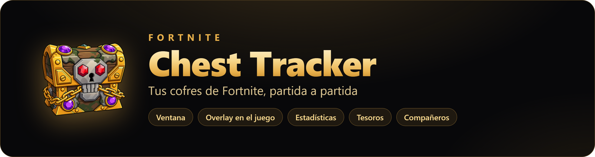
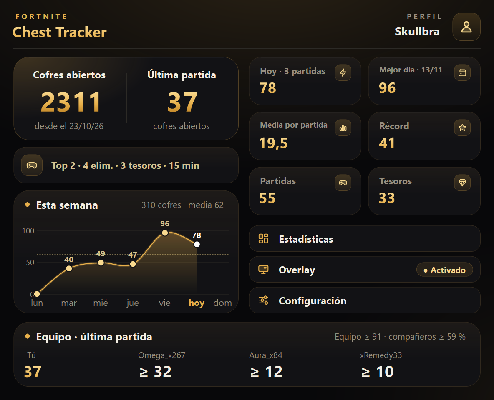
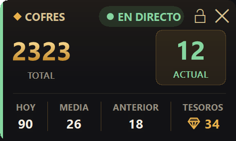
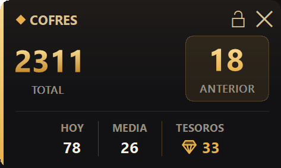
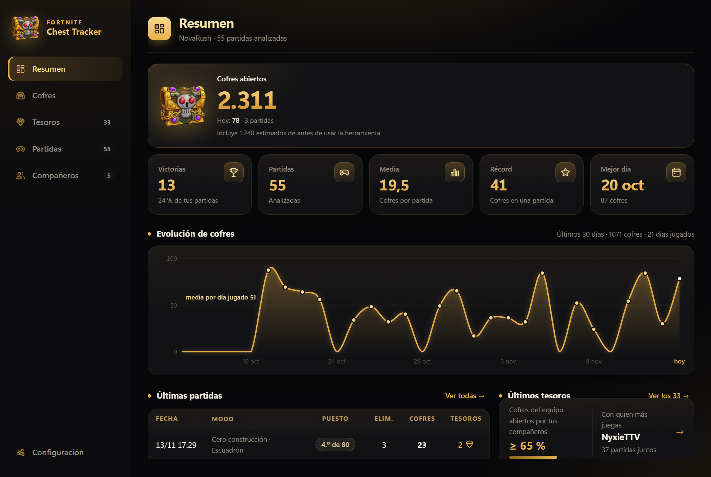
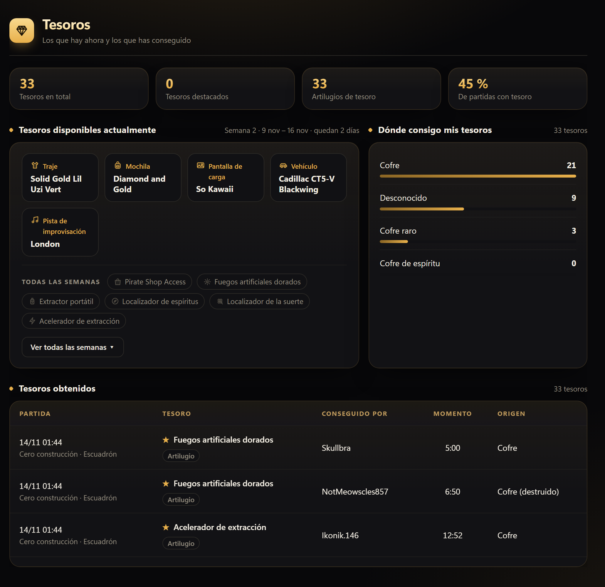
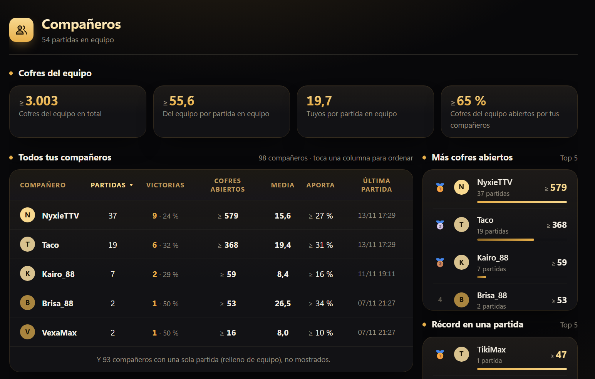
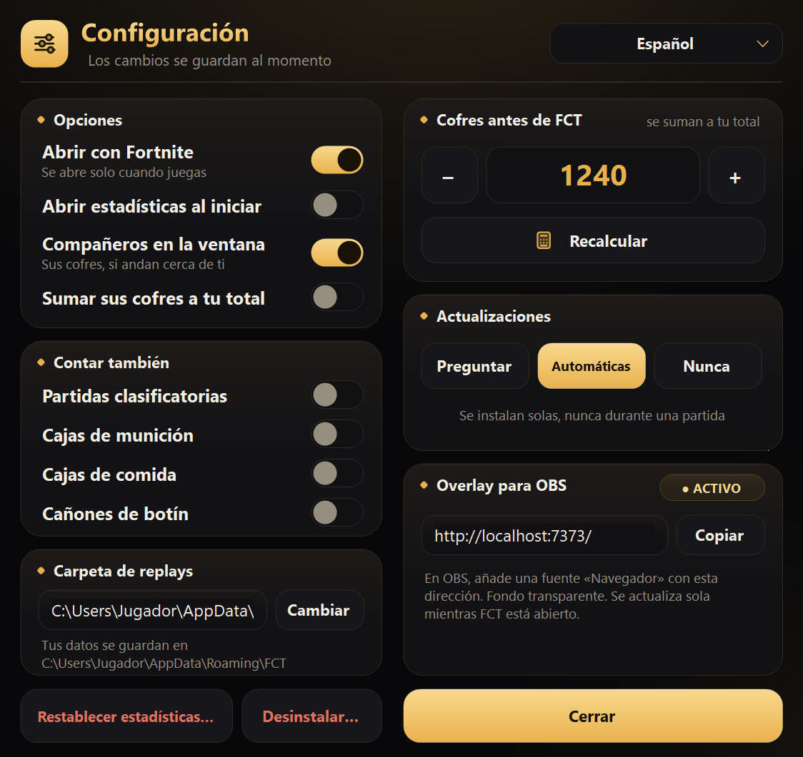

<div align="center">



**Español** · [English](README.en.md)

[](../../releases/latest) 

<a href="../../releases/latest"></a>

Un solo archivo · sin instalación · español e inglés

<br>



</div>

<br>

## Qué hace

FCT cuenta **cada cofre que abres en Fortnite**, partida a partida, sin que tengas que hacer nada: juegas y él lleva la cuenta.

|   |   |
|---|---|
| **Tu total de cofres** | De siempre, de hoy, tu mejor día, tu récord y tu media por partida. |
| **Overlay en el juego** | Tus cofres encima de Fortnite, y en directo mientras juegas. |
| **Estadísticas** | Una página con gráficos, tus partidas, tus tesoros y tu equipo. |
| **Tesoros** | Los de la caza del tesoro: cuáles has conseguido y cuáles hay esta semana. |
| **Compañeros** | Con quién juegas más y cuántos cofres abre cada uno. |
| **Para streamers** | El mismo overlay listo para OBS, con fondo transparente. |

Tu historial se queda guardado en tu PC.

<br>

## Empezar en 3 pasos

1. **Descarga [`FCT.exe`](../../releases/latest)** y ábrelo. No hay que instalar nada.
2. **Activa las repeticiones en Fortnite:** *Ajustes → Juego → Repeticiones → Grabar repeticiones*. Es lo que FCT lee para contar.
3. **Juega.** FCT se abre solo con Fortnite y cuenta tus cofres al terminar cada partida.

> [!NOTE]
> La primera vez, Windows puede enseñar un aviso azul (*"Windows protegió su PC"*). Es normal con programas nuevos que aún tienen pocas descargas: pulsa **Más información → Ejecutar de todas formas**.

<br>

## El overlay

<div align="center">
&nbsp;&nbsp;

<br><sub>Durante una partida (en directo) · Entre partidas</sub>
</div>

<br>

- Aparece solo cuando Fortnite está abierto, en la pantalla y el sitio que elijas.
- **Ctrl + Mayús + O** lo muestra u oculta.
- **Ctrl + Mayús + L** (o el candado) lo bloquea o desbloquea: bloqueado, los clics lo atraviesan; desbloqueado, lo arrastras donde quieras.
- Para verlo encima del juego, usa en Fortnite el modo **Pantalla completa en ventana**.
- **¿Haces directos?** En *Configuración* tienes la dirección para añadirlo en OBS como fuente de navegador.

<br>

## Tus estadísticas

Pulsa **Estadísticas** en FCT y se abren en tu navegador. Se actualizan solas mientras juegas.



**Tesoros** · los que has conseguido, de dónde salieron y los premios de esta semana.



**Compañeros** · con quién juegas, victorias juntos y quién abre más cofres.




<br>

## Configuración



Los cambios se guardan al momento:

- **Abrir con Fortnite**: FCT se abre y se cierra con el juego.
- **Compañeros**: ver los cofres de tu equipo y, si quieres, sumarlos a tu total.
- **Contar también** cajas de munición, de comida o cañones de botín.
- **Cofres de antes de FCT**: calcula los que abriste antes de instalarlo.
- **Actualizaciones** automáticas (o que te pregunte).
- **Idioma** (FCT se reinicia para cambiarlo), **overlay para OBS** y **desinstalar**.

<br clear="right">

<br>

## ¿Es seguro?

Sí. FCT **lee las repeticiones** que Fortnite guarda en tu PC, igual que si las abrieras tú:

- No toca el juego ni su memoria, y no interactúa con el antitrampas.
- Al acabar la partida mira la pantalla de tesoros para saber cuáles te tocaron; esa imagen se descarta al momento y nunca se guarda.
- Sin cuentas ni inicio de sesión, y sin anuncios.
- Nada sale de tu PC. Solo se conecta para buscar actualizaciones y, si tú lo pides, para calcular tus cofres de antes de FCT.
- Gasta muy poco: casi no hace nada entre partida y partida.

> [!TIP]
> **¿Prefieres comprobarlo tú?** Todo el código está en este repositorio. Pásaselo a la IA que uses (ChatGPT, Claude, Gemini…) y pregúntale si hace algo raro. FCT nació para una cosa: saber cuántos cofres abres.

<br>

## Preguntas rápidas

<details>
<summary><b>No me cuenta las partidas</b></summary>
<br>Revisa que las repeticiones estén activadas en Fortnite (<i>Ajustes → Juego → Repeticiones</i>). Solo se cuentan partidas de Battle Royale.
</details>

<details>
<summary><b>¿Por qué los cofres de mis compañeros salen bajos?</b></summary>
<br>Fortnite solo graba lo que pasa cerca de ti. Si un compañero se aleja mucho, sus cofres no aparecen: por eso se muestran como un mínimo (≥).
</details>

<details>
<summary><b>¿Pierdo mi historial si Fortnite borra las repeticiones?</b></summary>
<br>No. Cada partida se guarda en cuanto se lee, en <code>%APPDATA%\FCT</code>. Si cambias de PC, copia esa carpeta.
</details>

<details>
<summary><b>¿Y las partidas que juego con FCT cerrado?</b></summary>
<br>Se cuentan la próxima vez que lo abras, mientras Fortnite no haya borrado esas repeticiones. Con <b>Abrir con Fortnite</b> activado no tienes que acordarte.
</details>

<details>
<summary><b>¿Se actualiza solo?</b></summary>
<br>Sí, entre partida y partida, y sin perder tus datos. Puedes cambiarlo en <i>Configuración → Actualizaciones</i>.
</details>

<details>
<summary><b>¿Cómo lo desinstalo?</b></summary>
<br><i>Configuración → Desinstalar…</i> FCT se borra del PC sin dejar nada. Tus datos se quedan en <code>%APPDATA%\FCT</code>, por si vuelves; si no los quieres, borra esa carpeta.
</details>

<details>
<summary><b>Algo no funciona</b></summary>
<br>Abre un <a href="../../issues">issue</a> contando qué pasa y, si puedes, adjunta el archivo <code>errors.log</code> de <code>%APPDATA%\FCT</code>.
</details>

<br>

---

<details>
<summary><b>Para desarrolladores</b></summary>
<br>

Compila con el [SDK de .NET 10](https://dotnet.microsoft.com/download/dotnet/10.0) haciendo doble clic en `build.bat` (genera `dist\FCT.exe`), o abre `FCT.slnx`. Los cambios de cada versión están en el [CHANGELOG](CHANGELOG.md).

```
FCT.exe --once              analiza las repeticiones terminadas y se cierra
FCT.exe --demos <carpeta>   otra carpeta de repeticiones
FCT.exe --data <carpeta>    otra carpeta de datos
FCT.exe --licenses          licencia y avisos de terceros
FCT.exe --uninstall         quita FCT de Windows (tus datos se quedan)
```
</details>

## Licencia y créditos

**Fortnite Chest Tracker** · Copyright © 2026 Adrián Ruiz · Software libre con licencia [GPL-3.0](LICENSE) y las condiciones de atribución de [NOTICE.md](NOTICE.md): puedes usarlo, modificarlo y compartirlo, pero si publicas algo basado en él debes mantener esta licencia, mencionar al autor y este repositorio e indicar tus cambios. Las versiones hasta la 4.4.1 se publicaron con licencia MIT.

**Gracias a:**

- [**ChestCounter**](https://github.com/xdoofy92/ChestCounter), de xdoofy92: el proyecto en el que empezó FCT y del que salió la idea.
- [**FortniteReplayDecompressor**](https://github.com/Shiqan/FortniteReplayDecompressor), de Shiqan (MIT): la librería que lee las repeticiones de Fortnite.
- [**Fortnite-API**](https://fortnite-api.com): de ahí salen tus partidas de la temporada cuando calculas tus cofres de antes de FCT. [**fortnite.gg**](https://fortnite.gg/stats) se sugiere para mirarlas a mano si hace falta.
- Firma de código gratuita de [SignPath.io](https://about.signpath.io/), certificado de [SignPath Foundation](https://signpath.org/) ([política de firma de código](CODE_SIGNING_POLICY.md)).

Todo el código de terceros y sus licencias: [THIRD_PARTY_NOTICES.md](THIRD_PARTY_NOTICES.md) · Privacidad: [política de privacidad](CODE_SIGNING_POLICY.md#privacy-policy).

<sub>FCT es un proyecto independiente de fans y no está afiliado a Epic Games, Inc. ni cuenta con su respaldo. Fortnite y Epic Games son marcas comerciales o registradas de Epic Games, Inc. Fortnite-API y fortnite.gg son servicios no oficiales y ajenos a este proyecto.</sub>
