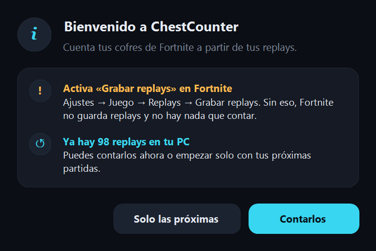
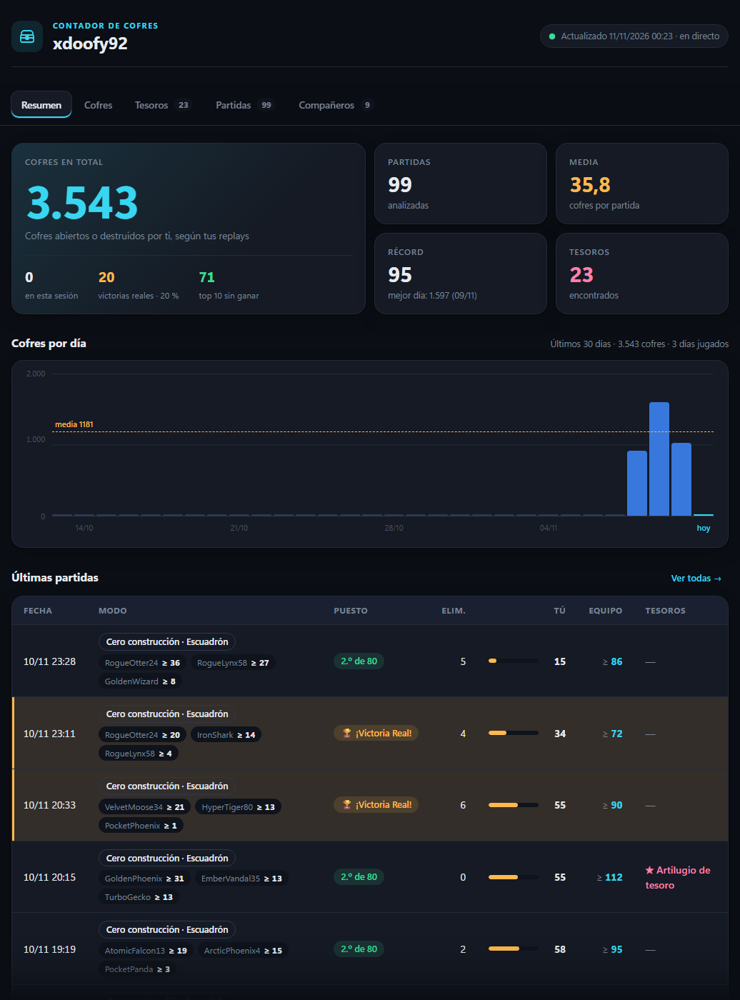
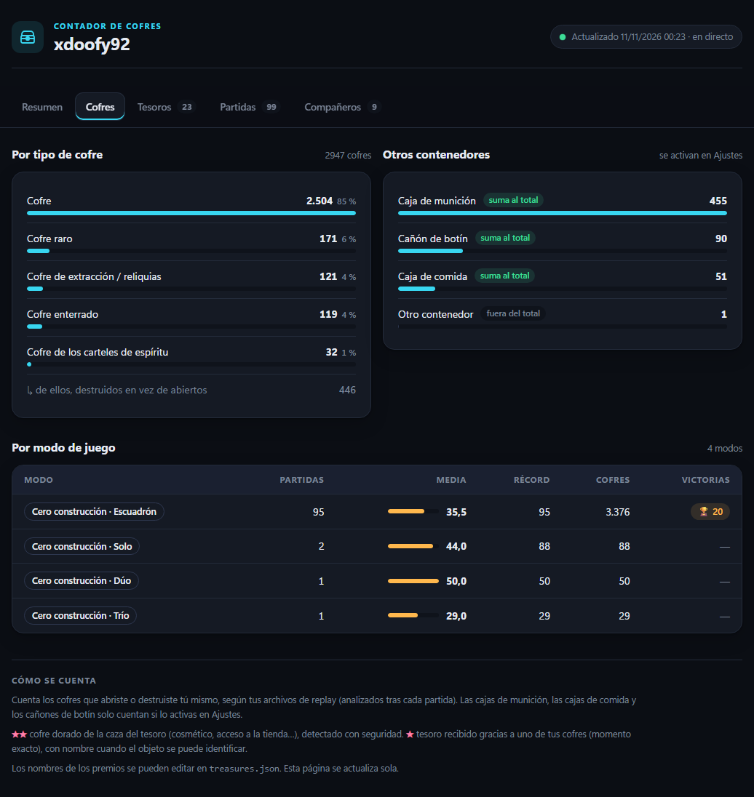
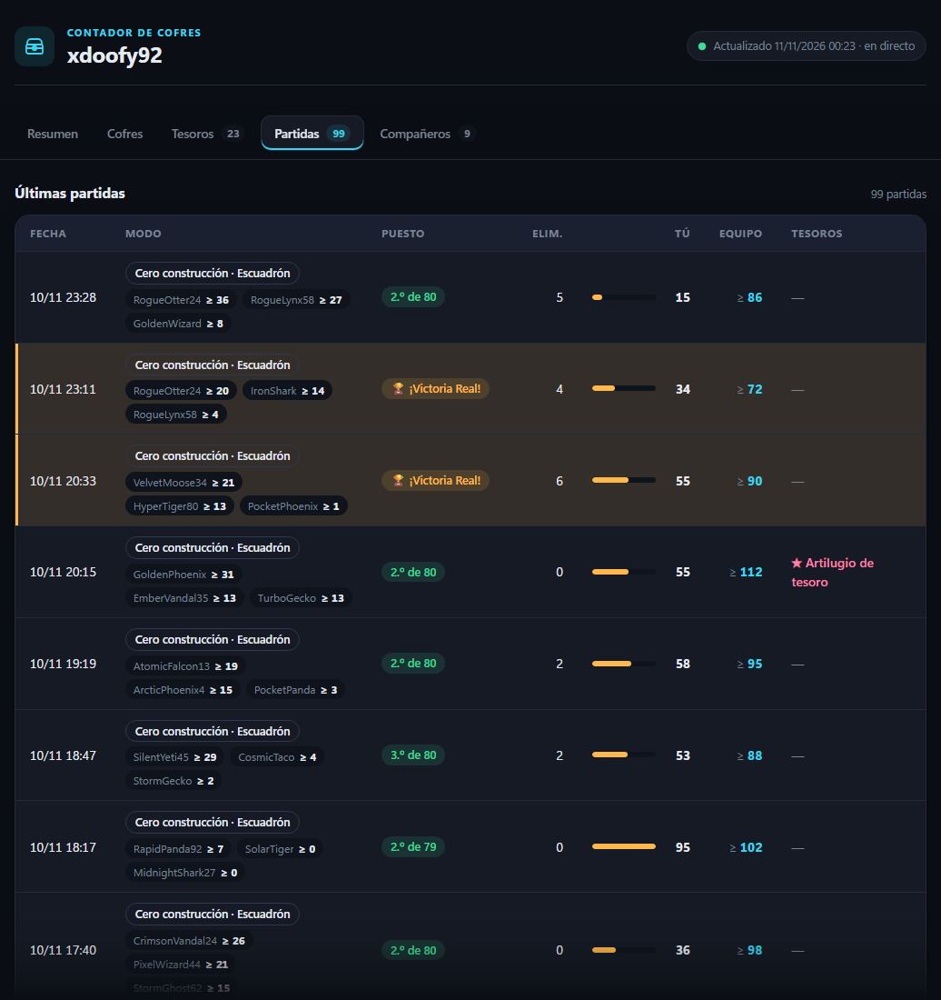
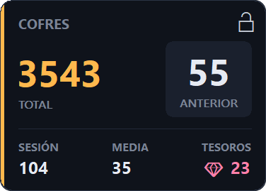
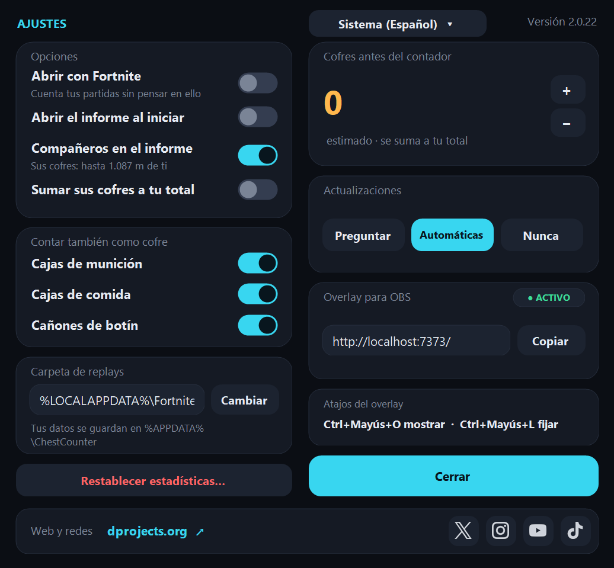

<div align="center">

**Español** · [English](README.en.md)

# Fortnite Chest Tracker (FCT)

[](../../releases/latest) [](../../releases)  [](LICENSE)

**Cuenta cada cofre que abres en Fortnite, partida tras partida: ventana, informe, overlay sobre el juego y los cofres de tu equipo.**

&nbsp;

[**⬇ Descargar FCT.exe**](../../releases/latest) · Windows 10 / 11 · gratis · sin instalación · 10 idiomas

</div>

---

FCT lee las repeticiones (replays) que Fortnite guarda de cada partida y lleva la cuenta de los cofres que abres, de los **tesoros de la caza del tesoro** y, si quieres, de los cofres de tus **compañeros de equipo**. Todo se guarda en tu PC: aunque Fortnite borre los replays, tu historial se conserva.

- **Ventana principal**: total, última partida, hoy, mejor día, media, récord, tesoros, gráfico de 7 días y tu equipo.
- **Informe** en el navegador, con pestañas: resumen, cofres, tesoros, partidas y compañeros.
- **Overlay** sobre el juego y **página para OBS**.
- **Compañeros**: con quién juegas, victorias juntos, cofres de cada uno por partida y un top.
- **Seguro**: solo lee archivos de replay; no toca el juego ni su memoria.

> Cuenta los cofres que **tú** abriste (y los que se vio abrir a tu equipo). No muestra dónde están los cofres en el mapa.

## Primeros pasos

1. Descarga **[`FCT.exe`](../../releases/latest)**. Ese único archivo es todo lo que necesitas.
2. En Fortnite activa *Ajustes → Juego → Repeticiones → **Grabar repeticiones*** (y *Modos de equipos grandes* si los juegas). Sin repeticiones no hay nada que leer.
3. Ejecuta `FCT.exe`.
   > Windows puede mostrar *"Windows protegió tu PC"* porque el exe no está firmado. Haz clic en *Más información → Ejecutar de todas formas*.
4. La bienvenida te recuerda lo de las repeticiones y, si ya tienes replays en el PC, te deja **contarlos** o empezar **solo con las próximas partidas**.

<p align="center"></p>

5. Déjalo abierto mientras juegas. Al abrirlo solo aparece el **overlay**: la ventana principal queda en segundo plano, con su icono en el área de notificación (la flecha **^** de la barra de tareas). Un clic en el icono, o abrir el programa otra vez, la trae delante; con clic derecho tienes overlay, informe, ajustes y salir. La primera vez, o si el overlay está desactivado, la ventana se abre como siempre. Durante la partida FCT lee el replay que se está grabando y suma los cofres **en directo**; al terminar, se confirman.

> [!TIP]
> Las partidas que juegas con FCT cerrado se cuentan la próxima vez que lo abras, mientras Fortnite no haya borrado esos replays (guarda un número limitado). Para no tener que pensar en ello, activa **Abrir con Fortnite** en Ajustes.

## La ventana principal

<p align="center"></p>

- **Arriba a la izquierda**: tu total de cofres, la última partida (o la actual, en verde, mientras juegas) y la sesión.
- **A la derecha**: hoy, el mejor día, la media, la mejor partida, el histórico (partidas guardadas y desde cuándo) y los tesoros.
- **Últimos 7 días**: un gráfico con los cofres de cada día.
- **Equipo** (con *Compañeros* activado): tus cofres y los de cada compañero en la partida actual o la última, el total del equipo y lo que aportan ellos.
- **Botones**: **Overlay** (punto verde = activado), **Informe** y **Ajustes**. Si hay varias cuentas en el PC, arriba aparece un selector de perfil.

La ventana se puede redimensionar y maximizar: todo crece en proporción.

## El informe

`report.html` se abre en tu navegador (botón **Informe**) y se actualiza solo. Empieza siempre en **Resumen**; arriba tienes las pestañas:

| Pestaña | Qué muestra |
|---|---|
| **Resumen** | Total de cofres, sesión, victorias (y %), top 10, partidas, media, récord, mejor día, tesoros, gráfico de 30 días y las últimas partidas. |
| **Cofres** | Por tipo de cofre, otros contenedores (cajas de munición, de comida, cañones; indica si suman al total) y una tabla **por modo de juego**. |
| **Tesoros** | Cuántos (destacados y artilugios), % de partidas con tesoro, de dónde vienen, la lista con el momento exacto y quién los consiguió, y todos los premios de la caza del tesoro por semana. |
| **Partidas** | Las 100 últimas: modo, puesto (🏆 victoria, top 10 en verde), eliminaciones, cofres, tesoros y, con compañeros, el equipo. |
| **Compañeros** | Cofres del equipo, **top de compañeros**, la tabla **por partida** y todos tus compañeros (ver abajo). |

<p align="center"></p>

<details>
<summary><b>Ver las demás pestañas</b></summary>

<p align="center"></p>
<p align="center"></p>
<p align="center"></p>
<p align="center"></p>

</details>

Usa los colores de la ventana (oscuro, o claro si Windows está en modo claro) y se adapta al móvil.

## Compañeros y equipo

Actívalo en **Ajustes → Compañeros en el informe** (desactivado por defecto). Verás:

- **Exacto**: con quién juegas, partidas juntos y victorias juntos.
- **Aproximado**: los cofres de cada compañero. Salen de **tu** replay, y Fortnite solo graba lo que pasa **a menos de 1.087 m de ti** (medido en replays reales). Si un compañero se aleja más, sus cofres no se cuentan: son un **mínimo (≥)**.
- **Cofres del equipo**: tú + tus compañeros, en total y por partida, con el % que aporta cada uno; útil si buscáis un objeto aleatorio que sale de los cofres.
- **Top de compañeros**: más cofres vistos, mejor media, récord en una partida y más victorias juntos.

Con **Sumar sus cofres a tu total** (también desactivado), tu total, media, récords y overlay incluyen los cofres de tu equipo. Tu historial no cambia: al desactivarlo vuelves a ver solo los tuyos.

## El overlay

<p align="center">&nbsp;&nbsp;</p>

- **Cifras grandes**: tu **total** de cofres y, en el recuadro, la partida **anterior** (o la **actual**, en directo, mientras juegas).
- **Sesión**, **media** de la sesión, **anterior** (durante una partida) y **tesoros**.

Para verlo sobre el juego, pon Fortnite en **Pantalla completa en ventana** (*Ajustes → Vídeo → Modo de ventana*): en pantalla completa exclusiva, Windows no puede dibujar nada encima. El overlay viene **desactivado**: actívalo con el botón **Overlay** o con Ctrl+Mayús+O.

¿Transmites en directo? Mientras FCT está abierto, el mismo overlay está en **http://localhost:7373/** (cópialo desde **Ajustes**). En OBS, añade una **fuente de navegador** con esa dirección: tiene fondo transparente y se actualiza sola.

### Atajos

| Atajo | Qué hace |
|---|---|
| **Ctrl+Mayús+O** | Mostrar / ocultar el overlay. Funciona en cualquier sitio, incluso en el juego. |
| **Ctrl+Mayús+L** | Bloquear / desbloquear el overlay. **Bloqueado**: el ratón lo atraviesa y no se mueve. **Desbloqueado**: arrástralo con el botón izquierdo. |
| Clic derecho en el overlay | Ocultarlo. |
| Botón **✕** del overlay (a la derecha del candado) | Cerrar FCT (la aplicación y el overlay). |

## Ajustes

<p align="center"></p>

- **Idioma**: por defecto el de Windows; arriba puedes elegir otro (español, inglés, portugués, ruso, francés, alemán, italiano, polaco, turco o japonés).
- **Abrir con Fortnite**: un pequeño proceso invisible abre FCT en segundo plano cuando arranca Fortnite y lo cierra 30 s después de cerrarlo. No lee nada del juego: solo mira la lista de programas en marcha.
- **Abrir el informe al iniciar** (desactivado por defecto).
- **Compañeros en el informe** y **Sumar sus cofres a tu total** (ver arriba).
- **Contar también como cofre**: cajas de munición, cajas de comida y cañones de botín (desactivado; no se borra nada al cambiarlo). Los cofres que **rompes** se cuentan siempre.
- **Cofres antes de FCT**: un estimado que se suma a tu total.
- **Actualizaciones**, **overlay para OBS**, **carpeta de replays** y **Restablecer estadísticas** (con copia de seguridad).

## Cómo funciona (y por qué es seguro)

Fortnite puede grabar un **archivo de repetición** de cada partida en tu PC. FCT lee esos archivos y nada más.

- ✅ **Solo lee archivos de repetición**: los `.replay` de `%LOCALAPPDATA%\FortniteGame\Saved\Demos`, en modo solo lectura.
- ✅ **Sin modificar el juego**: no toca la carpeta de instalación de Fortnite.
- ✅ **Sin acceso a la memoria del juego**: nunca lee, escribe ni inyecta nada en el proceso de Fortnite.
- ✅ **No envía datos**: sin inicio de sesión, sin cuenta de Epic, sin telemetría. El único acceso a la red es buscar versiones nuevas en GitHub (se puede desactivar).
- ✅ **Ligero**: prioridad baja ("modo de eficiencia" en Windows 11) y duerme entre partidas.

## Tesoros

- **★★ Tesoro destacado.** Los premios de la semana (traje, pico, vehículo, pista, pantalla de carga…) y el acceso a la tienda pirata. El servidor envía su **id**, así que aparecen con su nombre y su tipo.
- **★ Artilugio de tesoro.** Uno de los cinco artilugios (Golden Firework, Portable Extractor, Sprite Locator, Lucky Locator, Extraction Accelerator); el replay no dice cuál.
- Cada tesoro aparece con el momento exacto, el cofre del que salió y **quién lo abrió** (tú o un compañero): los tesoros del escuadrón se reparten, así que cuentan todos, como en la pantalla de fin de partida.
- Un tesoro que sale de algo que no es un cofre (cañón de botín, caja de munición…) se marca con ⚑.
- **Límite:** el replay solo contiene lo que el juego te envía a ti. Si te eliminan definitivamente (sin reinicio) o sales de la partida, los tesoros que consiga el escuadrón después **no quedan en el replay** y no se pueden contar; la partida lo indica con ⚠ en el informe. Nada en el PC los guarda (ni el log del juego); la única fuente completa es la pantalla de fin de partida.

Los premios conocidos ya tienen nombre. Si aparece uno nuevo, sale como "Tesoro destacado" y su id se añade a `treasures.json`, donde puedes ponerle nombre con el Bloc de notas.

## Perfiles (varias cuentas en un PC)

No hay nombre que escribir: se cuenta al jugador que grabó cada replay. Si hay replays de varias cuentas, cada una tiene su perfil y arriba a la derecha aparece un **desplegable** para elegir cuál se muestra.

## Actualizaciones

Al iniciarse, FCT busca en GitHub una versión nueva y, por defecto, la **instala sola** entre dos partidas (tu historial y tus ajustes se conservan). En Ajustes puedes elegir *Preguntar* o *Nunca* (ningún acceso a la red).

## Tus datos

Todo se guarda en `%APPDATA%\ChestCounter`. **Tu historial no depende de los replays**: cada partida (con sus cofres, tesoros y compañeros) se guarda en `data.json` en cuanto se lee, y todas las estadísticas salen de ahí.

| Archivo | Contenido |
|---|---|
| `data.json` | Tu historial completo. **Haz copia de seguridad** si cambias de PC. |
| `report.html` | El informe. |
| `matches.csv` | Una línea por partida, para Excel o Google Sheets. |
| `config.json` | Ajustes, perfil, carpeta de replays y posición del overlay. |
| `treasures.json` | Nombres de los premios de la caza del tesoro. |
| `overlay.html` | Copia del overlay (para OBS es mejor http://localhost:7373/). |
| `errors.log` | Replays que no se pudieron leer, para adjuntar a un informe de error. |

## Preguntas frecuentes

**No se cuenta nada.** Comprueba que las repeticiones están activadas en Fortnite. La ventana te avisa si falta la carpeta de replays o está vacía.

**¿Por qué los cofres de mis compañeros salen bajos?** Porque solo se ven los que abren a menos de 1.087 m de ti. Es un mínimo, no su total.

**¿Cómo empiezo de cero?** **Ajustes → Restablecer estadísticas…** (con confirmación y copia de seguridad `data-backup-….json`).

**¿Modos creativos?** Solo se cuentan las partidas de Battle Royale.

**"No se puede leer esta repetición".** Una actualización de Fortnite puede cambiar el formato. Las partidas ya contadas se conservan. Abre un [issue](../../issues) y adjunta `errors.log`.

**¿Una partida puede contarse dos veces?** No, aunque renombres o guardes el replay.

## Opciones de línea de comandos

```
FCT.exe --demos <carpeta>   otra carpeta de repeticiones
FCT.exe --data <carpeta>    otra carpeta de datos
FCT.exe --once              analiza las repeticiones terminadas y se cierra
FCT.exe --reset-config      vuelve a hacer la configuración inicial
FCT.exe --overlay-preview <archivo.png>   guarda vistas previas del overlay y se cierra
```

## Compilar desde el código

Instala el [SDK de .NET 10](https://dotnet.microsoft.com/download/dotnet/10.0) (Windows x64) y haz doble clic en **`build.bat`**: el exe se genera en `dist\FCT.exe`. GitHub Actions compila el exe en cada push y lo publica cuando se sube una etiqueta `v*`.

## Licencia y créditos

[MIT](LICENSE). Este proyecto parte de [ChestCounter](https://github.com/xdoofy92/ChestCounter) de xdoofy92. El análisis de los replays se basa en [FortniteReplayDecompressor](https://github.com/Shiqan/FortniteReplayDecompressor) de Shiqan (MIT), ligeramente modificado: ver [`lib/PATCHES.md`](lib/PATCHES.md).

Este proyecto no está afiliado a Epic Games, ni cuenta con su respaldo ni patrocinio. Fortnite es una marca registrada de Epic Games, Inc.
