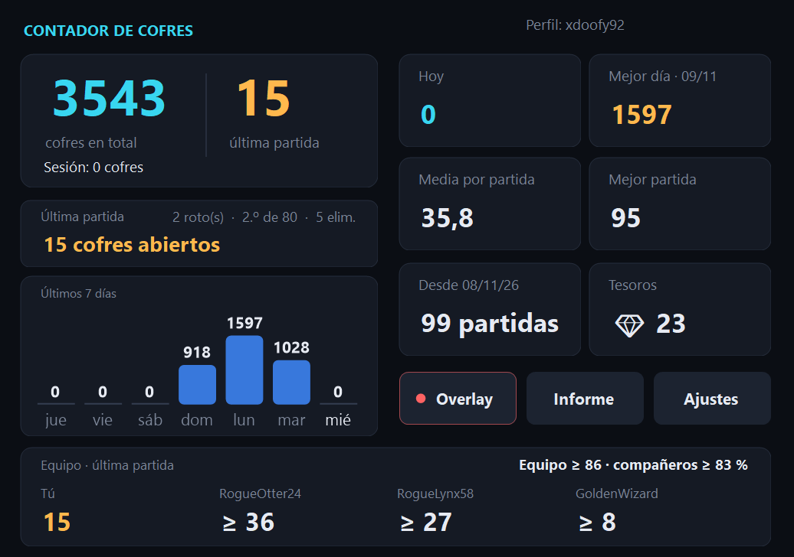
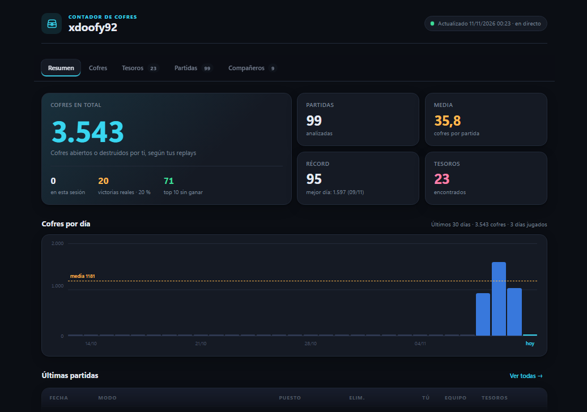
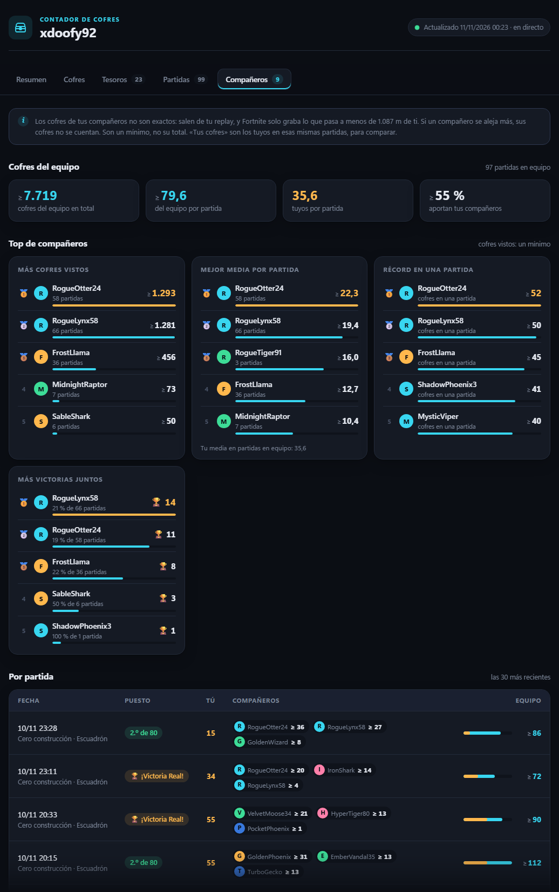
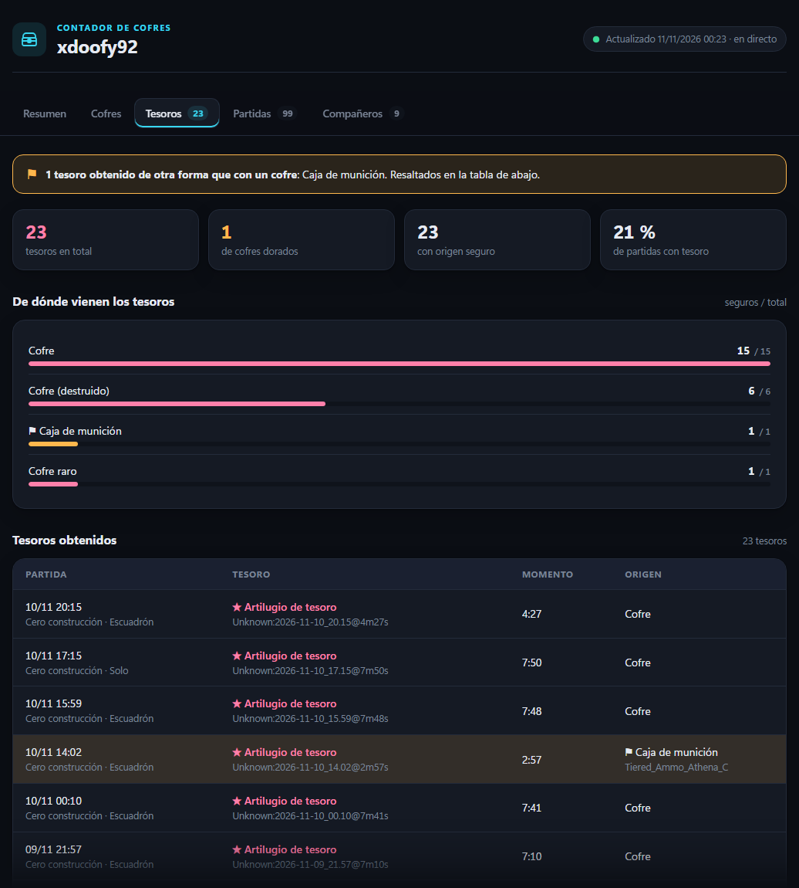
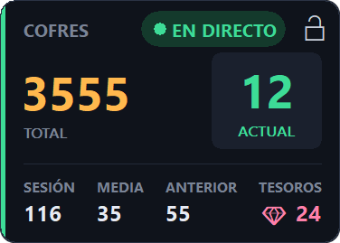

<div align="center">

**Español** · [English](README.en.md)

# Fortnite Chest Tracker (FCT)

[](../../releases/latest) [](../../releases)  [](LICENSE)

**Cuenta cada cofre que abres en Fortnite, partida tras partida: ventana, estadísticas, overlay sobre el juego y los cofres de tu equipo.**

&nbsp;

[**⬇ Descargar FCT.exe**](../../releases/latest) · Windows 10 / 11 · gratis · sin instalación · español e inglés

</div>

---

FCT lee las repeticiones (replays) que Fortnite guarda de cada partida y lleva la cuenta de los cofres que abres, de los **tesoros de la caza del tesoro** y, si quieres, de los cofres de tus **compañeros de equipo**. Todo se guarda en tu PC: aunque Fortnite borre los replays, tu historial se conserva.

- **Ventana principal**: total, última partida, hoy, mejor día, media, récord, tesoros, gráfico de la semana y tu equipo.
- **Estadísticas** en el navegador, con pestañas: resumen, cofres, tesoros, partidas, compañeros y configuración.
- **Overlay** sobre el juego y **página para OBS**.
- **Compañeros**: con quién juegas, victorias juntos, cofres de cada uno por partida y un top.
- **Seguro**: solo lee archivos de replay; no toca el juego ni su memoria.

> Cuenta los cofres que **tú** abriste (y los que se vio abrir a tu equipo). No muestra dónde están los cofres en el mapa.

## Primeros pasos

1. Descarga **[`FCT.exe`](../../releases/latest)**. Ese único archivo es todo lo que necesitas.
2. En Fortnite activa *Ajustes → Juego → Repeticiones → **Grabar repeticiones*** (y *Modos de equipos grandes* si los juegas). Sin repeticiones no hay nada que leer.
3. Ejecuta `FCT.exe`.
   > Si Windows avisa, pulsa *Más información → Ejecutar de todas formas*. Pasa porque el programa aún no está firmado.
4. La bienvenida te recuerda lo de las repeticiones y, si ya tienes replays en el PC, te deja **contarlos** o empezar **solo con las próximas partidas**.

<p align="center"></p>

5. Déjalo abierto mientras juegas:
   - **Con Fortnite abierto**, al abrir FCT solo aparece el **overlay** y la ventana queda en segundo plano, con su icono en el área de notificación (la flecha **^** de la barra de tareas). Un clic en el icono, o abrir el programa otra vez, la trae delante; con clic derecho tienes overlay, estadísticas, configuración y salir.
   - **Sin Fortnite**, se abre la ventana.
   - La **X de la ventana** la deja en segundo plano si Fortnite está abierto; si no, cierra FCT. La **✕ del overlay** cierra FCT entero.
   - En segundo plano, FCT se cierra solo al cerrar Fortnite (en cuanto cuenta la última partida), o desde **Salir** en su icono.
    Durante la partida FCT lee el replay que se está grabando y suma los cofres **en directo**; al terminar, se confirman.

> [!TIP]
> Las partidas que juegas con FCT cerrado se cuentan la próxima vez que lo abras, mientras Fortnite no haya borrado esos replays (guarda un número limitado). Para no tener que pensar en ello, activa **Abrir con Fortnite** en Ajustes.

## La ventana principal

<p align="center"></p>

- **Arriba a la izquierda**: tu total de cofres, la última partida (o la actual, en verde, mientras juegas) y lo de hoy (cofres, partidas y media).
- **A la derecha**: hoy, el mejor día, la media, la mejor partida, el histórico (partidas guardadas y desde cuándo) y los tesoros.
- **Esta semana**: un gráfico con los cofres de cada día, de lunes a domingo.
- **Equipo** (con *Compañeros* activado): tus cofres y los de cada compañero en la partida actual o la última, el total del equipo y lo que aportan ellos.
- **Botones**: **Overlay** (punto verde = activado), **Estadísticas** y **Configuración**. Si hay varias cuentas en el PC, arriba aparece un selector de perfil.

La ventana se puede redimensionar y maximizar: todo crece en proporción.

## Las estadísticas

La página de estadísticas se abre en tu navegador (botón **Estadísticas**), servida por FCT en `http://localhost:7373/estadisticas`, y se actualiza sola; si cierras FCT, la página avisa en vez de dar error. También queda guardada como `estadisticas.html`. Empieza siempre en **Resumen**; las pestañas están en el menú de la izquierda. En un PC cada pestaña cabe en la pantalla: las listas largas se desplazan dentro de su propio recuadro.

| Pestaña | Qué muestra |
|---|---|
| **Resumen** | Cofres abiertos (y los de hoy), victorias, partidas, media, récord, mejor día, gráfico de los últimos 30 días, últimas partidas, **últimos tesoros** (con el icono de cada objeto) y, con compañeros, lo que aportan y con quién más juegas. |
| **Cofres** | Por tipo de cofre, otros contenedores (cajas de munición, de comida, cañones; indica si suman al total) y una tabla **por modo de juego** con los tesoros de cada modo. |
| **Tesoros** | Cuántos (destacados y artilugios), % de partidas con tesoro, **tesoros disponibles actualmente** (los de la semana y, con un botón, las cinco semanas en una fila), dónde consigues tus tesoros y la lista con el momento exacto y quién los consiguió. |
| **Partidas** | Las 100 últimas: modo, puesto (🏆 victoria, top 10 en verde), eliminaciones, cofres, tesoros y, con compañeros, el equipo. |
| **Compañeros** | Cofres del equipo, la tabla de **todos tus compañeros** (se ordena por partidas, victorias, cofres, media…) y el top 5 de más cofres abiertos y récord en una partida (ver abajo). |
| **Configuración** | La de las estadísticas: el idioma se comparte con la app (cambia ambas y reinicia FCT), y el resto solo cambia esta página (mostrar compañeros y sumar sus cofres, y qué contar como cofre). También la versión de FCT y enlaces a GitHub. |

<p align="center"></p>

<details>
<summary><b>Ver las demás pestañas</b></summary>

<p align="center"></p>
<p align="center"></p>
<p align="center"></p>
<p align="center"></p>

</details>

Negro y dorado, como la ventana, y se adapta al móvil.

## Compañeros y equipo

Viene activado: en la página (**Configuración → Mostrar compañeros** de estadísticas) y en la ventana (**Configuración → Compañeros en la ventana** de la app); se puede quitar en cada sitio. Verás:

- **Exacto**: con quién juegas, partidas juntos y victorias juntos.
- **Aproximado**: los cofres de cada compañero. Salen de **tu** replay, y Fortnite solo graba lo que pasa **a menos de 1.087 m de ti** (medido en replays reales). Si un compañero se aleja más, sus cofres no se cuentan: son un **mínimo (≥)**.
- **Cofres del equipo**: tú + tus compañeros, en total y por partida, con el % que aporta cada uno; útil si buscáis un objeto aleatorio que sale de los cofres.
- **Todos tus compañeros**: partidas juntos, victorias, cofres abiertos, media y lo que aportan; toca una columna para ordenar. Al lado, el top 5 de más cofres abiertos y de récord en una partida.

Con **Sumar sus cofres a tu total** (desactivado por defecto), tu total, media, récords y overlay incluyen los cofres de tu equipo. Tu historial no cambia: al desactivarlo vuelves a ver solo los tuyos.

## El overlay

<p align="center">&nbsp;&nbsp;</p>

- **Cifras grandes**: tu **total** de cofres y, en el recuadro, la partida **anterior** (o la **actual**, en directo, mientras juegas).
- **Hoy**, **media** de hoy por partida, **anterior** (durante una partida) y **tesoros**.

Para verlo sobre el juego, pon Fortnite en **Pantalla completa en ventana** (*Ajustes → Vídeo → Modo de ventana*): en pantalla completa exclusiva, Windows no puede dibujar nada encima. Solo se ve mientras Fortnite está abierto (sin minimizar) en alguna pantalla; entonces puedes ponerlo en cualquier pantalla y sitio, y se sigue viendo aunque uses otra ventana. No se puede sacar por los bordes. Al abrir FCT con Fortnite abierto se enciende; lo apagas con el botón **Overlay** o con Ctrl+Mayús+O.

¿Transmites en directo? Mientras FCT está abierto, el mismo overlay está en **http://localhost:7373/** (cópialo desde **Configuración**). En OBS, añade una **fuente de navegador** con esa dirección: tiene fondo transparente y se actualiza sola.

### Atajos

| Atajo | Qué hace |
|---|---|
| **Ctrl+Mayús+O** | Mostrar / ocultar el overlay. Funciona en cualquier sitio, incluso en el juego. |
| **Ctrl+Mayús+L** | Bloquear / desbloquear el overlay. **Bloqueado**: el ratón lo atraviesa y no se mueve. **Desbloqueado**: arrástralo con el botón izquierdo. |
| Clic derecho en el overlay | Ocultarlo. |
| Botón **✕** del overlay (a la derecha del candado) | Cerrar FCT (la aplicación y el overlay). |

## Configuración

La de la app (botón **Configuración**) cambia la ventana y el overlay; la página de estadísticas tiene la suya en su pestaña **Configuración** (salvo el idioma, que es compartido).

<p align="center"></p>

- **Idioma**: por defecto el de Windows (español o inglés; inglés si es otro); arriba puedes elegir el otro (es bidireccional con el de la página de estadísticas).
- **Abrir con Fortnite** (activado desde el primer uso): FCT se abre en segundo plano cuando arranca Fortnite, y se cierra solo al cerrarlo. Entre partida y partida no queda nada en marcha ni en el inicio de Windows: es una tarea programada de tu usuario (sin permisos de administrador) que salta cuando el antitrampas de Fortnite se carga, algo que Windows anota en su registro. No lee nada del juego. Se quita desde Ajustes (y la ves en el Programador de tareas como «Fortnite Chest Tracker»).
- **Abrir estadísticas al iniciar** (desactivado por defecto).
- **Compañeros en la ventana** y **Sumar sus cofres a tu total** (ver arriba).
- **Contar también como cofre**: cajas de munición, cajas de comida y cañones de botín (desactivado; no se borra nada al cambiarlo). Los cofres que **rompes** se cuentan siempre.
- **Cofres antes de FCT**: un estimado que se suma a tu total. Se pregunta la primera vez y se puede rehacer en **Configuración → Recalcular**: eliges *Empezar de cero* / *Solo las guardadas* o *Calcular partidas previas*:
  - **Partidas de la temporada actual**: se buscan con tu nombre de Epic. Solo si no se encuentran (o tu perfil es privado, y se avisa) se escriben a mano mirando [fortnite.gg](https://fortnite.gg/stats).
  - **Media de cofres por partida**: la de tus repeticiones junto con las **partidas nuevas** que juegues desde ese momento (eliges cuántas: 5 por defecto, **10 recomendado**; cuantas más, más acertada). Cada repetición pesa como una partida nueva, así que cuantas más repeticiones tengas, más cuentan. O escríbela a mano.
  - **Estimado** = media × (partidas de la temporada − repeticiones de esta temporada ya contadas; las de temporadas anteriores entran en la media pero no se restan). La media se redondea hacia abajo solo si no tenías ninguna repetición o tenías 100 o más (el máximo que guarda Fortnite). Hasta jugar las partidas nuevas verás un estimado provisional. Sin repeticiones, lo de antes es solo el estimado.
- **Actualizaciones**, **overlay para OBS**, **carpeta de replays**, **Restablecer estadísticas** (con copia de seguridad) y **Desinstalar** (ver [Desinstalar](#desinstalar)).

## Cómo funciona (y por qué es seguro)

Fortnite puede grabar un **archivo de repetición** de cada partida en tu PC. FCT lee esos archivos y nada más.

- ✅ **Solo lee archivos de repetición**: los `.replay` de `%LOCALAPPDATA%\FortniteGame\Saved\Demos`, en modo solo lectura.
- ✅ **Sin modificar el juego**: no toca la carpeta de instalación de Fortnite.
- ✅ **Sin acceso a la memoria del juego**: nunca lee, escribe ni inyecta nada en el proceso de Fortnite.
- ✅ **No envía datos**: sin inicio de sesión, sin cuenta de Epic, sin telemetría. Acceso a la red: buscar versiones nuevas en GitHub (se puede desactivar) y, solo si pulsas **Buscar** al estimar, consultar tus partidas de la temporada en fortnite-api.com (se envía tu id o nombre de Epic, nada más).
- ✅ **Ligero**: prioridad baja ("modo de eficiencia" en Windows 11) y duerme entre partidas.

## Tesoros

- **★★ Tesoro destacado.** Los premios de la semana (traje, pico, vehículo, pista, pantalla de carga…) y el acceso a la tienda pirata. El servidor envía su **id**, así que aparecen con su nombre y su tipo.
- **★ Artilugio de tesoro.** Uno de los cinco artilugios (Golden Firework, Portable Extractor, Sprite Locator, Lucky Locator, Extraction Accelerator). El replay no dice cuál: lo dice la **pantalla de tesoros del final de la partida**, que FCT lee sola (ver abajo). Si no se pudo leer, aparece como "Artilugio de tesoro".
- Cada tesoro aparece con el momento exacto, el cofre del que salió y **quién lo abrió** (tú o un compañero): los tesoros del escuadrón se reparten, así que cuentan todos, como en la pantalla de fin de partida.
- Un tesoro que sale de algo que no es un cofre (cañón de botín, caja de munición…) se marca con ⚑.
- **Pantalla de fin de partida.** Cuando Fortnite muestra "Tesoro encontrado", FCT captura **solo la ventana del juego** (aunque esté detrás de otras ventanas, en ventana o a pantalla completa), reconoce los iconos y **borra la imagen en el acto**: nunca se guarda. Primero se cuenta todo con el replay, como siempre; la pantalla solo pone nombre a los artilugios y añade los que el replay no vio (por ejemplo, después de tu eliminación), con hora y jugador **desconocidos**. Si el juego está minimizado en ese momento, no hay nada que capturar y la partida queda solo con el replay. No toca el proceso del juego: la misma técnica que la captura de ventana de OBS.
- **Límite del replay:** solo contiene lo que el juego te envía a ti. Si te eliminan definitivamente (sin reinicio) o sales de la partida, los tesoros que consiga el escuadrón después no están en el replay; solo la pantalla de fin de partida los recupera.

Los premios conocidos ya tienen nombre. Si aparece uno nuevo, sale como "Tesoro destacado" y su id se añade a `treasures.json`, donde puedes ponerle nombre con el Bloc de notas.

## Perfiles (varias cuentas en un PC)

No hay nombre que escribir: se cuenta al jugador que grabó cada replay. Si en el PC juegan varias cuentas:

- **Cada una tiene su perfil** con todo su historial, que se guarda aunque Fortnite borre los replays (también si ya tenía más de 100 contados). Nada se mezcla.
- **FCT sigue al que juega**: cuando empieza o termina una partida de otra cuenta, la ventana, el overlay y las estadísticas pasan a su perfil y avisa («Ahora juega X»). La partida en directo de uno nunca se suma al otro.
- Para ver otro perfil, elígelo en el **desplegable** de arriba a la derecha de la ventana: se respeta hasta la siguiente partida.
- **Cofres antes de FCT** es de cada jugador: cada uno puede calcular sus partidas previas sin pisar las del otro.

## Actualizaciones

FCT busca en GitHub una versión nueva al iniciarse y **cada 30 minutos** mientras está abierto, y por defecto la **instala sola** entre dos partidas (tu historial y tu configuración se conservan). En Configuración puedes elegir *Preguntar* o *Nunca* (ningún acceso a la red). La primera vez que lo abres, si no es la última versión, te pregunta si quieres descargarla; si dices que no, las actualizaciones quedan en *Preguntar*.

## Tus datos

Todo se guarda en `%APPDATA%\FCT`. **Tu historial no depende de los replays**: cada partida (con sus cofres, tesoros y compañeros) se guarda en `data.json` en cuanto se lee, y todas las estadísticas salen de ahí.

| Archivo | Contenido |
|---|---|
| `data.json` | Tu historial completo. **Haz copia de seguridad** si cambias de PC. |
| `estadisticas.html` | Las estadísticas. |
| `matches.csv` | Una línea por partida, para Excel o Google Sheets. |
| `config.json` | Configuración de la app y del resumen, perfil, carpeta de replays y posición del overlay. |
| `treasures.json` | Nombres de los premios de la caza del tesoro. |
| `overlay.html` | Copia del overlay (para OBS es mejor http://localhost:7373/). |
| `errors.log` | Replays que no se pudieron leer, para adjuntar a un informe de error. |

## Desinstalar

**Configuración → Desinstalar…** (o `FCT.exe --uninstall` desde una terminal): FCT se cierra y borra todo lo que deja en Windows, sin tener que desactivar nada antes: el propio `FCT.exe`, la tarea programada de *Abrir con Fortnite*, las entradas de inicio de versiones anteriores y los restos de actualizaciones. **Tus datos se quedan** en `%APPDATA%\FCT` (si vuelves a instalar FCT, los recupera); si quieres borrarlos también, borra esa carpeta a mano.

Si borras el exe a mano sin desinstalar, la tarea programada se queda (inofensiva: no puede abrir nada); la quitas abriendo FCT otra vez y desinstalando, o desde el Programador de tareas (*Fortnite Chest Tracker*).

## Preguntas frecuentes

**No se cuenta nada.** Comprueba que las repeticiones están activadas en Fortnite. La ventana te avisa si falta la carpeta de replays o está vacía.

**¿Por qué los cofres de mis compañeros salen bajos?** Porque solo se ven los que abren a menos de 1.087 m de ti. Es un mínimo, no su total.

**¿Cómo empiezo de cero?** **Configuración → Restablecer estadísticas…** (con confirmación y copia de seguridad `data-backup-….json`).

**¿Modos creativos?** Solo se cuentan las partidas de Battle Royale.

**"No se puede leer esta repetición".** Una actualización de Fortnite puede cambiar el formato. Las partidas ya contadas se conservan. Abre un [issue](../../issues) y adjunta `errors.log`.

**¿Una partida puede contarse dos veces?** No, aunque renombres o guardes el replay.

## Opciones de línea de comandos

```
FCT.exe --demos <carpeta>   otra carpeta de repeticiones
FCT.exe --data <carpeta>    otra carpeta de datos
FCT.exe --once              analiza las repeticiones terminadas y se cierra
FCT.exe --reset-config      vuelve a hacer la configuración inicial
FCT.exe --overlay-preview <archivo.png>   guarda vistas previas del overlay y se cierra
FCT.exe --licenses          muestra la licencia y los avisos de terceros
FCT.exe --uninstall         quita FCT de Windows (tarea, inicio y el exe); tus datos se quedan
```

## Compilar desde el código

Instala el [SDK de .NET 10](https://dotnet.microsoft.com/download/dotnet/10.0) (Windows x64) y haz doble clic en **`build.bat`**: el exe se genera en `dist\FCT.exe`. También puedes abrir `FCT.slnx` en Visual Studio o VS Code. GitHub Actions compila el exe en cada push; al publicar una release en GitHub, le adjunta `FCT.exe`. Los cambios de cada versión están en [CHANGELOG.md](CHANGELOG.md).

### Estructura del proyecto

```
src/                         la aplicación: FCT.csproj → FCT.exe
├─ Program.cs                arranque y opciones de línea de comandos
├─ App/                      versión, actualizaciones, inicio con Fortnite, traslado de datos, registro de errores
├─ Analysis/                 lectura de replays: cofres, tesoros, premios, perfiles
├─ Data/                     lo que se guarda: partidas, ajustes y el almacén JSON
├─ Monitoring/               el proceso en segundo plano (vigila replays, overlay y actualizaciones)
├─ PostMatch/                pantalla de tesoros de fin de partida: captura de la ventana del juego y lectura de iconos
├─ Overlay/                  overlay sobre el juego y su versión para OBS
├─ Reporting/                estadísticas (HTML)
├─ UI/                       ventana principal, configuración y controles
├─ Localization/             idioma de la app; Languages/ para añadir idiomas (ver su README)
└─ Assets/                   icono
external/FortniteReplayDecompressor/   librería de replays (modificada: ver PATCHES.md)
tools/i18n.cs                crea o actualiza el archivo de un idioma nuevo (dotnet run tools/i18n.cs -- <código>)
docs/images/                 capturas de este README
```

## Licencia, créditos y avisos legales

**Copyright © 2026 Adrián Ruiz.** FCT es software libre con la licencia [GNU GPL versión 3](LICENSE) y las condiciones adicionales de [NOTICE.md](NOTICE.md) (las versiones hasta la 4.4.1 se publicaron con MIT y siguen siéndolo):

- Puedes usarlo, estudiarlo, modificarlo y compartirlo.
- Si distribuyes FCT o algo basado en él (gratis o de pago), debes publicar todo el código con esta misma licencia, **mencionar al autor y este repositorio** («Based on Fortnite Chest Tracker by Adrián Ruiz — https://github.com/adrc4-ua/Fortnite-Chest-Tracker») e indicar que es una versión modificada; no puede ser de código cerrado ni presentarse como el FCT original.
- Te pido, sin que sea una condición de la licencia, que **me avises antes** de publicar algo basado en este código, abriendo un [issue](../../issues).

Todo lo externo que usa, con su licencia o sus condiciones, está en [THIRD_PARTY_NOTICES.md](THIRD_PARTY_NOTICES.md). Todo esto va también dentro del exe (`FCT.exe --licenses`) y en **Acerca de y licencia**, en el menú del icono de FCT.

**Código y origen**

| | Para qué | Licencia |
|---|---|---|
| [FortniteReplayDecompressor](https://github.com/Shiqan/FortniteReplayDecompressor) de Shiqan | Leer y descomprimir las repeticiones. Va incluido en `external/`, con cambios propios descritos en [`PATCHES.md`](external/FortniteReplayDecompressor/PATCHES.md). | MIT |
| [ChestCounter](https://github.com/xdoofy92/ChestCounter) de xdoofy92 | FCT es un fork de ChestCounter: partió de su idea, su código y su historial (hasta el 11/11/2026) y desde entonces evoluciona por separado. Parte de su código sigue en FCT, así que su aviso de copyright y su licencia MIT se conservan en [THIRD_PARTY_NOTICES.md](THIRD_PARTY_NOTICES.md). | MIT |
| [.NET](https://github.com/dotnet/runtime) y Windows Forms | El exe lleva el runtime de .NET dentro, para no tener que instalar nada. | MIT |

**Servicios** (ninguno recibe datos sin que lo pidas; detalle en la [política de privacidad](CODE_SIGNING_POLICY.md#privacy-policy))

| | Para qué | Qué se envía |
|---|---|---|
| [GitHub](https://github.com) | Buscar y descargar versiones nuevas (se puede desactivar). | Nada tuyo. |
| [Fortnite-API](https://fortnite-api.com) | Solo cuando lo pides, buscar tus partidas de la temporada actual para estimar los cofres de antes de FCT (estadísticas públicas), con la clave gratuita del proyecto. | Tu id o nombre de Epic, nada más. |
| [fortnite.gg](https://fortnite.gg/stats) | FCT **no** se conecta: solo se sugiere como web donde puedes mirar tú tus partidas y escribirlas a mano si la búsqueda falla. | Nada. |

### Code signing policy

Firma de código gratuita de [SignPath.io](https://about.signpath.io/), certificado de [SignPath Foundation](https://signpath.org/). Qué se firma, quién lo aprueba, privacidad y cómo desinstalar: [política de firma de código](CODE_SIGNING_POLICY.md).

### Marcas

FCT es un proyecto independiente de fans. **No está afiliado a Epic Games, Inc., ni cuenta con su respaldo, patrocinio o aprobación.** Fortnite, Epic Games y sus logotipos son marcas comerciales o registradas de Epic Games, Inc. Fortnite-API y fortnite.gg son servicios no oficiales y ajenos a este proyecto. FCT solo lee las repeticiones que el juego guarda en tu PC: no modifica el juego, no lee su memoria ni interactúa con su antitrampas.
